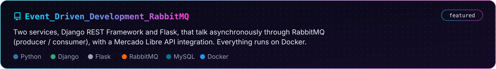
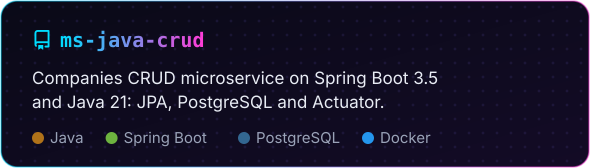
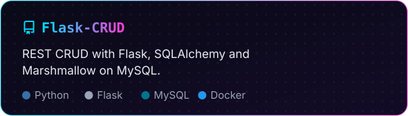

  <picture><source media="(max-width: 640px)" srcset="assets/banner-mobile.svg"></picture>

I build backend systems and the platforms that run them, with **Java**, **Python**, **React** and **AWS**.

**Previously:** Banco Azteca · TV Azteca · Merama

## 👨‍💻 What I do

- Build backend services and APIs with Java (Spring Boot) and Python.
- Set up AWS infrastructure with Terraform, Docker and CI/CD pipelines.
- Lead small teams through code reviews and shared standards.

## 🧰 Tech stack

   
   
  

**Also:** microservices · event-driven · DDD · TDD · SonarQube · Dynatrace · Claude Code

## 🚀 Featured projects

  <a href="https://github.com/ingnatoz/Event_Driven_Development_RabbitMQ"><picture><source media="(max-width: 640px)" srcset="assets/projects/Event_Driven_Development_RabbitMQ-mobile.svg"></picture></a>
  <a href="https://github.com/ingnatoz/ms-java-crud"><picture><source media="(max-width: 640px)" srcset="assets/projects/ms-java-crud-mobile.svg"></picture></a>
  <a href="https://github.com/ingnatoz/google_book_api"><picture><source media="(max-width: 640px)" srcset="assets/projects/google_book_api-mobile.svg"></picture></a>
  <a href="https://github.com/ingnatoz/flask_dynamo_s3"><picture><source media="(max-width: 640px)" srcset="assets/projects/flask_dynamo_s3-mobile.svg"></picture></a>
  <a href="https://github.com/ingnatoz/Flask-CRUD"><picture><source media="(max-width: 640px)" srcset="assets/projects/Flask-CRUD-mobile.svg"></picture></a>

---

Full experience on <a href="https://www.linkedin.com/in/miguel-natanael">LinkedIn</a>

