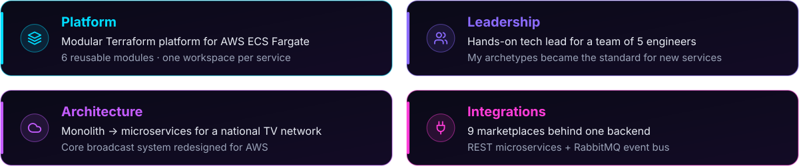
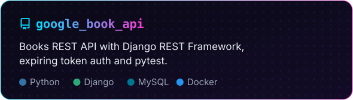
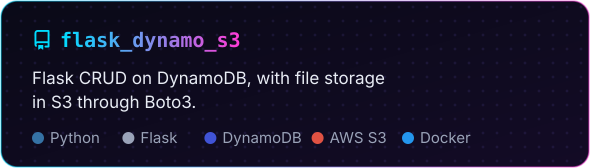

  

I build backend systems and the platforms that run them, with **Java**, **Python**, **React** and **AWS**.

**Previously:** Banco Azteca · TV Azteca · Merama

## ⚡ Impact

## 🧰 Tech stack

   
   
  

**Also:** microservices · event-driven · DDD · TDD · SonarQube · Dynatrace · Claude Code

## 🚀 Featured projects

  
  
  
  
  

---

Full experience on <a href="https://www.linkedin.com/in/miguel-natanael">LinkedIn</a>

